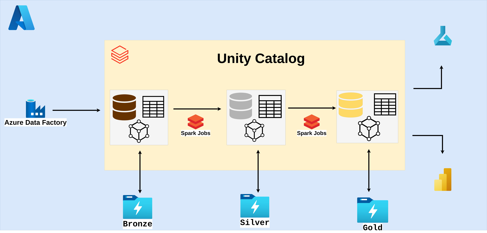

# Modern Data Stack with Azure and Databricks: From Ingestion to Analytics and AI
This repository contains the code for building a modern data platform using Azure services and Databricks and is the official code repository for the book "Modern Data Stack with Azure and Databricks: From Ingestion to Analytics and AI"

In "Modern Data Stack with Azure and Databricks: From Ingestion to Analytics and AI", we explore how to leverage Azure services and Databricks to create a robust, scalable, and efficient data platform. The book covers various aspects of data engineering, data science, and analytics, providing practical examples and best practices for building a modern data stack.


## Overview architecture




## Unity Catalog environment setup

```bash
python -m venv .venv/dbw-cluster
source .venv/dbw-cluster/bin/activate
pip install -e . && pip install -r dev-requirements.txt
```

## Unit tests environment setup

```bash
python -m venv .venv/dbw-ut
source .venv/dbw-ut/bin/activate
pip install -e . && pip uninstall -y -r test-excluded-requirements.txt && pip install -r test-requirements.txt
```